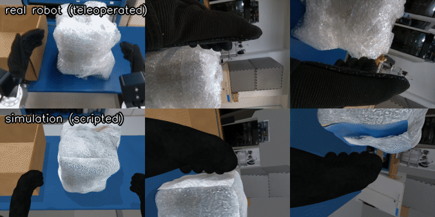

# Stage 5: Train ACT and deploy it



**What you will have at the end of this stage**

- One training set that mixes real and sim episodes.
- An ACT policy trained on it (on a GPU machine), and a quick CPU test that proves the pipeline on your PC.
- The policy running closed loop in the lab sim, with a success count.
- A checklist and a guarded command to run it on the real robot.

**Prerequisites**

- [Stage 4](../04_recording/README.md): the `g1lab` env and at least one dataset.
- New words (ACT, policy, checkpoint, action chunk, closed loop): see the [glossary](../docs/GLOSSARY.md).

In every new terminal:

```bash
source scripts/env.sh g1lab
```

## 1. Get the datasets

Use your own from stage 4, or download ours:

```bash
hf download <LAB_HF_ORG>/g1_pick_cube_real_waist --repo-type dataset --local-dir datasets/real_waist
```

```bash
hf download <LAB_HF_ORG>/g1_box_into_box_sim_scripted --repo-type dataset --local-dir datasets/sim_scripted_waist
```

You should see a `meta/`, `data/` and `videos/` folder in each.

| Folder | Content | Joints |
|---|---|---|
| `datasets/real_waist` | 52 real teleop episodes, padded with waist = 0 | 15 |
| `datasets/sim_scripted_waist` | Scripted sim episodes, waist moves | 15 |

If you only have the 14-joint real set, pad it first: `python -m g1lab.pad_waist datasets/pick_cube_real datasets/real_waist`.

## 2. Merge real + sim

Check that the sets are compatible (same fps, robot type and features):

```bash
python 05_training/merge_datasets.py --check-only --out datasets/mixed_waist datasets/real_waist datasets/sim_scripted_waist
```

You should see one line per source and `compatible`. If it prints a difference instead, the usual cause is 14 vs 15 joints.

Merge:

```bash
python 05_training/merge_datasets.py --out datasets/mixed_waist --repo-id local/mixed_waist \
    datasets/real_waist datasets/sim_scripted_waist
```

You should see the episode index range of each source and the new dataset in `datasets/mixed_waist`.

- `--out` must not exist yet.
- Different task sentences are fine. They become separate task entries.
- The merge joins whole datasets. To change the real:sim balance, merge a subset, or train with `-- --dataset.episodes=[...]` (see step 4).

**Warning: the waist.** The real episodes never moved the waist. A 15-joint policy trained **only** on them has zero variance on that joint: at run time any tiny waist reading becomes a huge input and the policy misbehaves. Always mix in data with waist motion (the sim set), or train a 14-joint policy on `g1_pick_cube_real`. `run_act.py` prints a warning when a checkpoint has this problem.

## 3. Smoke test on the CPU (100 steps)

This does **not** give a useful policy. It only proves that data loading, training and checkpoint saving work on your PC.

```bash
05_training/train_act.sh --root datasets/sim_scripted_waist --repo-id local/sim_scripted_waist \
    --output outputs/act_smoke --steps 100 --batch-size 2 --device cpu
```

You should see the full `+ lerobot-train ...` command, then `Start offline training on a fixed dataset`, a log line every 10 steps, and at the end the folder `outputs/act_smoke/checkpoints/last/pretrained_model/`.

- Close the simulator and other heavy programs first. ACT has about 52 million parameters and training needs several GB of RAM.
- `--output` must not exist yet (or pass `--resume`).

## 4. Train on a GPU

Training happens on another machine. Two routes:

| Route | How |
|---|---|
| Any GPU PC or cloud GPU | Clone this repo there, run `install/install.sh` and `install/setup_g1lab_env.sh` (then install a CUDA build of PyTorch in the `g1lab` env), copy or download the dataset, and run the command below. |

```bash
05_training/train_act.sh --root datasets/mixed_waist --repo-id local/mixed_waist --output outputs/act_mixed
```

| Option | Default | What it does |
|---|---|---|
| `--root DIR` | none | Local dataset folder. Without it the dataset is downloaded from the Hub by `--repo-id`. |
| `--repo-id NAME` | required | Dataset name (a label for local data) |
| `--output DIR` | required | Where checkpoints go |
| `--steps N` | 100000 | Training steps |
| `--batch-size N` | 8 | Batch size |
| `--device` | `cuda` | `cuda` or `cpu` |
| `--save-freq`, `--log-freq`, `--num-workers`, `--job-name` | LeRobot defaults | Passed on |
| `--resume` | off | Continue from `<output>/checkpoints/last` |
| `-- ...` | | Everything after `--` goes to `lerobot-train`, e.g. `-- --policy.chunk_size=50 --policy.n_action_steps=50` |

- The script wraps `lerobot-train` with `--policy.type=act`. It never pushes anything to the Hub and logs nothing to Weights & Biases.
- The policy size follows the dataset: a 15-joint dataset gives a policy that also turns the waist.
- The checkpoint to deploy is `<output>/checkpoints/last/pretrained_model/`. Copy that folder back to your PC.

## 5. Evaluate in the sim

Terminal 1:

```bash
scripts/run_sim.sh --scene lab --randomize
```

Terminal 2:

```bash
source scripts/env.sh g1lab
python 05_training/run_act.py --policy-path outputs/act_mixed/checkpoints/last/pretrained_model --episodes 10
```

You should see:

```
[act] act from outputs/act_mixed/checkpoints/last/pretrained_model: state/action 15, cameras [...], chunk 100 / plays 100
...
[act] done: N/10 successful episodes
```

Each episode starts with a sim reset (new random layout with `--randomize`) and ends on success or after `--max-seconds`.

| Option | Default | What it does |
|---|---|---|
| `--policy-path DIR` | required | The `pretrained_model` folder |
| `--episodes N` | 1 | Number of rollouts. Successes are counted in sim. |
| `--max-seconds S` | 30 | Time limit per episode |
| `--n-action-steps K` | from the checkpoint | Re-plan every K steps instead of playing the whole predicted chunk |
| `--device` | `cpu` | `cuda` if this PC has one |
| `--record DIR` | off | Save the rollouts as a LeRobot dataset (`--save-on success` keeps successes only) |
| `--dry-run` | off | Compute actions from the live cameras and joints but **send nothing** |
| `--max-vel`, `--max-lead` | 1.0 rad/s, 0.25 rad | Safety limits, see step 6 |
| `--ramp-time`, `--ramp-vel` | 2 s, 0.4 rad/s | Slow move from the current pose to the first action |
| `--end start\|hold` | `start` | After the episodes: go slowly back to the start pose, or hold |
| `--domain`, `--image-port` | 1, 60000 | For a second sim |

- On a CPU each new action chunk takes 0.2-0.5 s to compute. The robot pauses briefly at each re-plan.
- A policy from the 100-step smoke test will move but not solve the task. That is expected.

## 6. Real robot

**Status: implemented, not yet run on the real robot.** Read everything in this section before you try.

First, with the robot on and **nothing commanding it**, a dry run. It reads the real cameras and joints, computes actions, and sends nothing:

```bash
python 05_training/run_act.py --policy-path outputs/act_mixed/checkpoints/last/pretrained_model \
    --target real --dry-run --max-seconds 10
```

Then the real run:

```bash
python 05_training/run_act.py --policy-path outputs/act_mixed/checkpoints/last/pretrained_model --target real
```

It prints this checklist and waits until you type `yes`:

| Check | Why |
|---|---|
| G1 hanging on the gantry or stand, area around the arms clear, emergency stop in reach of a second person | The arms move by themselves |
| Robot in **debug mode** (L2+R2 on the remote) | `run_act.py` sends `rt/lowcmd`, like xr_teleoperate without `--motion` |
| Nothing else is commanding the robot (teleop, MCP server, another `run_act.py`) | Two controllers fight. Check with `python -m g1lab.record_live --target real --root /tmp/check`: the status line must show `src -`. |
| Image server running on the robot's PC2 with head and both wrist cameras; scene and light like in the training data | The policy only knows what it saw in training |
| Checkpoint trained for this robot and camera setup; tried in sim and with `--dry-run` first | |
| Limits you accept: `--max-vel`, `--max-lead`, `--max-seconds` | |

Safety built into `run_act.py`, every control tick:

| Guard | What it does |
|---|---|
| Start ramp | The robot moves slowly (at most `--ramp-vel`) from its current pose to the first action before the policy takes over |
| Joint limits | Arm limits from the URDF, waist within +-1.0 rad. Non-finite actions are replaced by "hold". |
| Lead limit | The command never runs more than `--max-lead` rad ahead of the measured joint |
| Velocity limit | The command changes at most `--max-vel` rad/s |
| Time limit | `--max-seconds` per episode |
| **Ctrl+C** | Stops the policy and **holds the current pose**. A second Ctrl+C exits. |

With `--motion` the arms are driven through `rt/arm_sdk` (robot in motion mode) and the waist is not driven.

## 7. Why this repo has its own runner

Unitree's `unitree_lerobot` ships `eval_g1.py` for this job. We do not use it because, at the time of writing:

- it fails with the current image server: it still uses the old image client API ([unitree_lerobot issue #103](https://github.com/unitreerobotics/unitree_lerobot/issues/103));
- it assumes a stereo head camera and splits the head image in two halves. Our head camera is mono.

`run_act.py` loads the same LeRobot checkpoint format, so a policy trained with `unitree_lerobot` or plain `lerobot-train` runs with it.

## 8. Run the tests (optional)

```bash
source scripts/env.sh g1lab
python -m pytest 05_training/tests -q
```

## Troubleshooting

- **`... exists; pick a new --output or pass --resume`**: choose another `--output` folder.
- **`... is not a LeRobot dataset (no meta/info.json)`**: `--root` must be the dataset folder itself.
- **Training is killed or the PC freezes**: out of memory. Close the sim, lower `--batch-size`, add `--num-workers 0`.
- **`Torch not compiled with CUDA enabled`**: the `g1lab` env installs CPU PyTorch. Use `--device cpu`, or install a CUDA build on the GPU machine.
- **`[act] WARNING: observation.state joints [...] never moved in the training data`**: see the waist warning in step 2. Retrain on mixed data.
- **`expected a 14- or 15-joint G1 policy`**: the checkpoint was trained on another robot layout.
- **The robot in sim does not move with `run_act.py`**: another controller is still running (teleop, scripted policy), or `--domain` / `--image-port` do not match the sim.
- **Merge refuses the datasets**: read the printed difference. Pad the 14-joint set with `g1lab.pad_waist`, or record both with the same `--no-waist` setting.
- **`Your dataset must be tagged with a codebase version`** when training from the Hub: tag the dataset `v3.0` (see [docs/PUBLISHING.md](../docs/PUBLISHING.md)).

More cases: [docs/TROUBLESHOOTING.md](../docs/TROUBLESHOOTING.md).

**You have reached the end of the pipeline.** Back to the [main README](../README.md).
